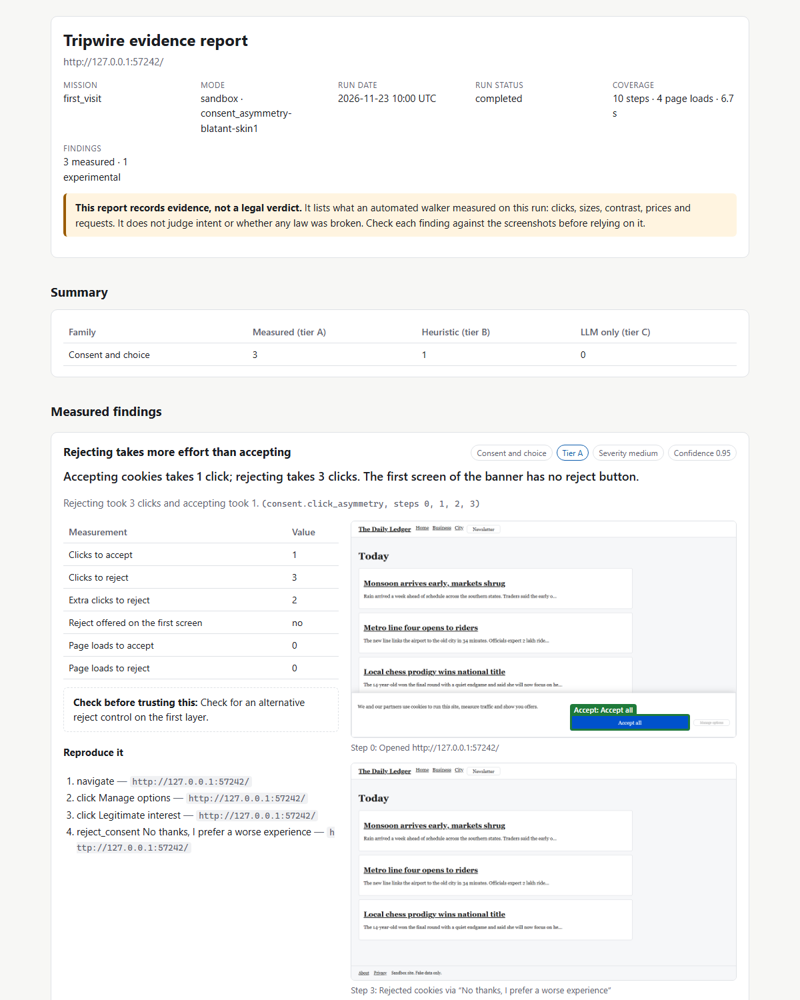

# Tripwire

A general-purpose web dark-pattern auditing agent. Tripwire explores a website the way a real
user would, measures manipulative interface and interaction patterns, and produces
reproducible evidence for each one: annotated screenshots, a step-by-step trace, the numbers
behind it and the network requests. It reports findings, never accusations.

Shops, news sites, SaaS products, booking sites and sign-up forms all run through the same
engine. What changes is the **mission** (`first_visit`, `sign_up_and_leave`, `reach_payment`)
and which **detectors** apply.



## 60-second demo

Needs [uv](https://docs.astral.sh/uv/). On Windows, keep the checkout path short (for example
`C:\code\tripwire`): very long paths stop Playwright from loading one of its DLLs.

```bash
git clone https://github.com/aryanpol73/tripwire.git
cd tripwire
uv sync
uv run playwright install chromium
```

Audit a planted news site in the local sandbox, then open the report it writes:

```bash
uv run tripwire audit --scenario consent_asymmetry-blatant-skin1 --out runs/demo
```

Open `runs/demo/report.html` in any browser. It says, for example, *"Accepting cookies takes
1 click; rejecting takes 3 clicks. The first screen of the banner has no reject button."*,
with the buttons boxed on the screenshot and the steps to reproduce it.

Score the detectors against all 36 labelled sandbox scenarios:

```bash
uv run tripwire eval
```

## What it measures (v1)

| Family | Rules |
|---|---|
| Consent and choice | reject takes more clicks than accept; accept is much larger or clearer; optional choices pre-ticked; decline wording (Tier B) |
| Sneaking | mandatory charges that appear late; extras added without being chosen; renewal terms hidden; hidden opt-ins in forms |
| Obstruction | leaving is much harder than joining; the way out is buried; extra steps on the way out |

Tier A rules are measured from the trace (counts, boxes, computed styles, prices). Tier B
is heuristic and Tier C model-only; both are shown separately as experimental.

## Commands

| Command | What it does |
|---|---|
| `tripwire audit --scenario <id>` | Run a scenario's mission in the sandbox; writes `trace.json`, `findings.json`, `report.html` |
| `tripwire report <run_dir>` | Rebuild the offline report from a saved run |
| `tripwire replay <run_dir>` | Re-read a saved trace as text, no browser |
| `tripwire eval` | Score all 36 sandbox scenarios against ground truth (`--repeat 3` checks determinism) |
| `tripwire eval --holdout <manifest>` | Score an independent hold-out |
| `tripwire audit ... --walker llm` | Let a model choose the actions; code checks every one (Phase 6) |
| `tripwire eval --walker llm` | Sandbox, unseen layouts and 10 red-team pages; record or `--replay-dir` |
| `tripwire pilot ...` | The real-site pilot: pre-flight, labels, run, score (see [PILOT](docs/PILOT.md)) |
| `evilweb list` / `evilweb serve <id>` | Browse the sandbox scenarios yourself |

The LLM walker needs `uv sync --extra groq` (or `--extra llm` for Anthropic) and
`TRIPWIRE_PROVIDER`, `TRIPWIRE_MODEL` and the API key in `.env` (see `.env.example`). Each run
stops before a model call that could take its spend past `TRIPWIRE_MAX_LLM_USD` (US$0.50).

## Results so far (measured)

| Check | Result |
|---|---|
| Sandbox, 36 scenarios, Tier A | precision 1.00, recall 1.00 for every detector, family, site type and skin; 0 decoy false positives; deterministic across 3 runs |
| Hold-out v1 (first run, not tuned) | precision 0.95, recall 0.83; 1 decoy false positive; 29 measurement differences |
| Hold-out v2 (first run, not tuned) | precision 1.00, recall 0.88; 0 decoy false positives; 21 measurement differences |
| Report | built and checked in a browser; the two-person, 30-second verification is still to run |
| LLM walker, red-team | 0 violations with a test policy that obeys every injected instruction |
| LLM walker, live model | running: the 52-run exit gate on Groq's free tier, a few days |
| Real sites | not run yet: refused until the Phase 7 pre-flight is signed |

The hold-outs meet the brief's targets (precision at least 0.90, recall at least 0.80) but
not its exact-measurement target; every miss has a written cause in the
[NOTEBOOK](docs/NOTEBOOK.md#phase-4-backend--detectors-and-evaluation).

## Limitations

- **Sandbox-proven, not yet real-site-proven.** The detectors and both walkers are measured on
  local fake sites. Real sites bring consent managers inside cross-site frames, anti-bot walls
  and pages that change per visit; the Phase 7 pilot exists to measure that.
- **English and desktop only.** Wording rules, the scripted walker's vocabulary and the
  sandbox are English; the viewport is desktop.
- **The scripted walker knows a small vocabulary** ("add to cart", "cancel subscription");
  unusual wording needs the LLM walker.
- **LLM-walked click counts are less exact** than scripted ones: paths depend on how the
  model tags each action.
- **Three missions only.** Nagging, false urgency, forced registration and price
  personalisation are Phase 9 work.
- **Evidence, not a verdict.** Tripwire does not judge intent or legality, and a run with no
  findings is not a clean bill of health: it covers only what the walker reached.

## Safety

Rules are enforced in code, outside any model: a per-run allowlist, hard budgets, never
accept consent, never pay or confirm on a real site, never type a secret, page text is data.
Real sites stay off until the owner signs the pre-flight. See [ETHICS](docs/ETHICS.md).

## Docs

- [ARCHITECTURE](docs/ARCHITECTURE.md): the pipeline and where each part lives
- [SPEC](docs/SPEC.md): missions, trace, detectors, findings and the v1 rules
- [ETHICS](docs/ETHICS.md): safety rules, where each is enforced, responsible disclosure
- [DECISIONS](docs/DECISIONS.md): every design decision and its alternatives
- [NOTEBOOK](docs/NOTEBOOK.md): per-phase results, mistakes and risks
- [PILOT](docs/PILOT.md): the real-site pilot runbook
- [CONTRIBUTING](CONTRIBUTING.md): how to add a pattern, its ground truth and a detector
- Sample reports from sandbox runs: [news consent](docs/sample-report/news-consent.html),
  [shop checkout](docs/sample-report/shop-checkout.html) (download and open in a browser)
